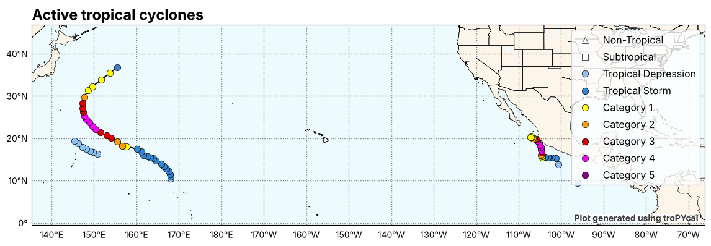
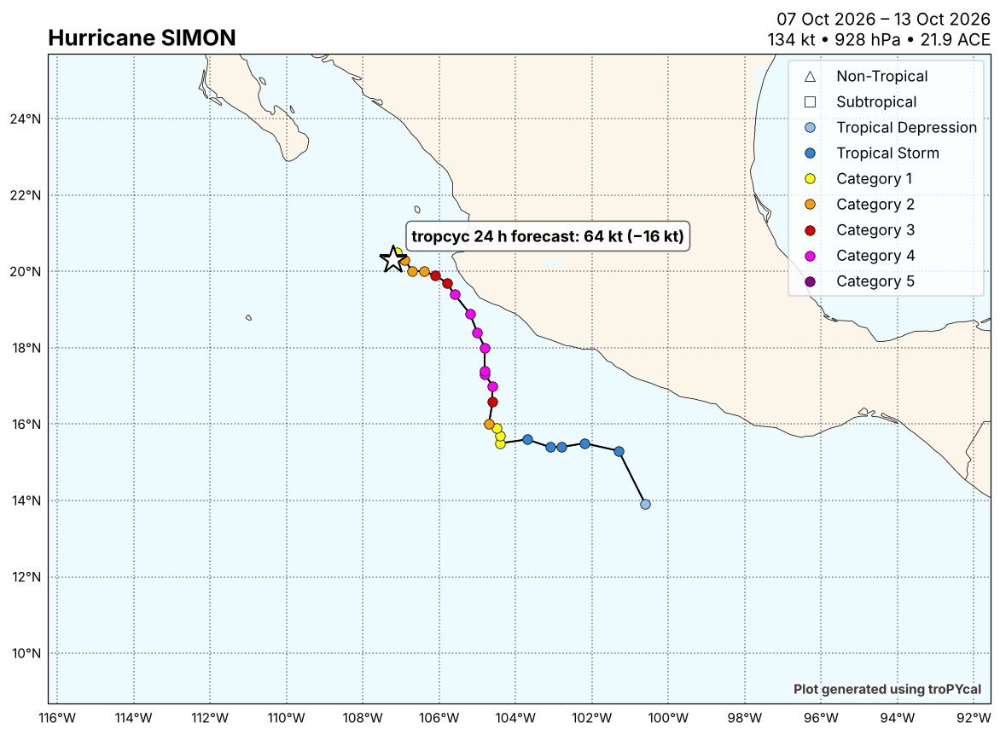
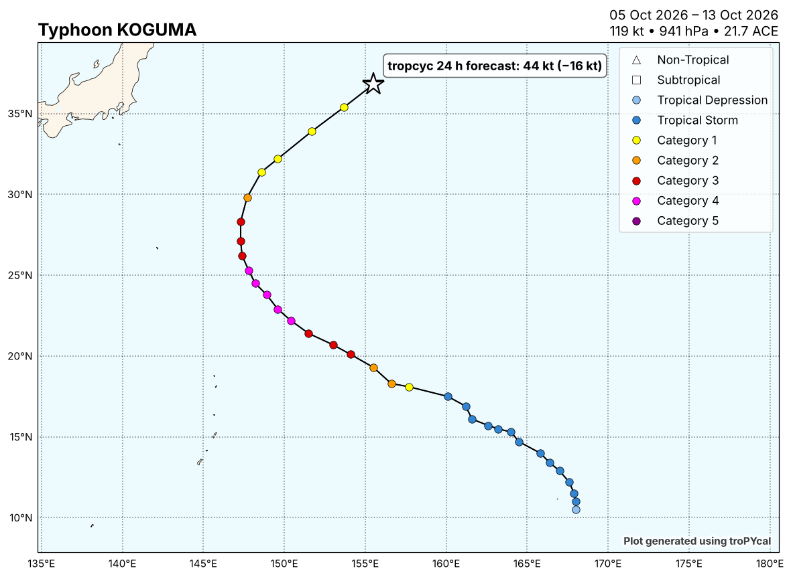
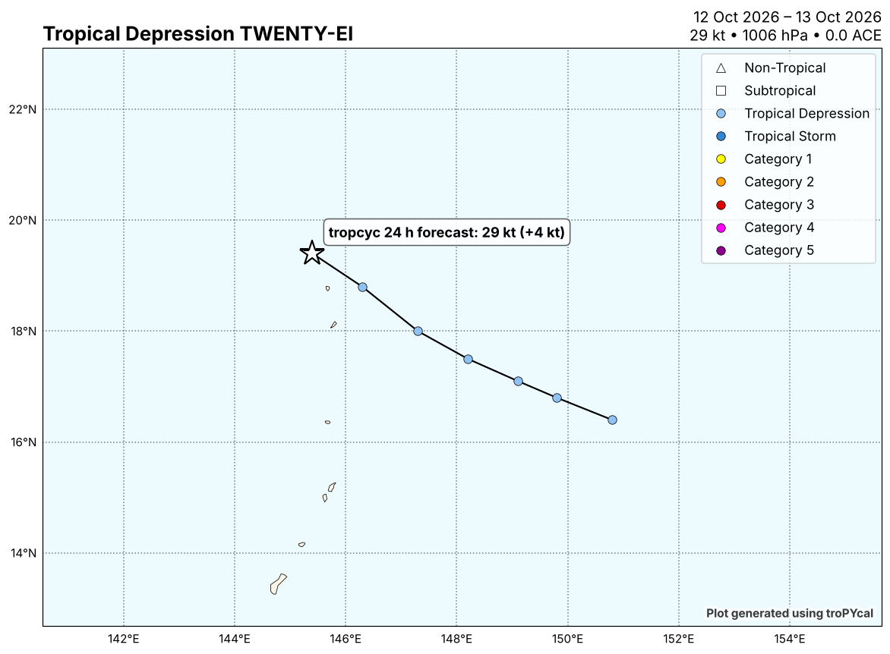

::: caveat
**Experimental research output, not an official forecast.** For decisions use the National Hurricane Center, the Joint Typhoon Warning Center, or your national weather service.
:::

```{=html}
<figure id="fig:overview">

<figcaption>Every active tropical cyclone, track coloured by Saffir–Simpson category (map drawn with tropycal).</figcaption>
</figure>
```

Model: **gradient boosting**, from track predictors only (see [Results](results.html)). Storm positions and intensities: TC vitals, latest fix 13 Oct 12 UTC.

::: {style="overflow-x:auto"}
| storm | basin | last fix (UTC) | position | now (kt) | 24 h change (kt) | forecast (kt) |
|:--|:--|:--|:--|--:|--:|--:|
| Simon (EP20) | East Pacific | 13 Oct 12:00 | 20.3° N, 107.2° W | 80 | −16 | **64** |
| Koguma (WP27) | West Pacific | 13 Oct 12:00 | 36.8° N, 155.5° E | 60 | −16 | **44** |
| Depression WP28 | West Pacific | 13 Oct 12:00 | 19.4° N, 145.4° E | 25 | +4 | **29** |

Table: Active storms and their forecast maximum wind 24 h after the last fix. {#tbl:live}
:::

## Simon (EP20)

Last fix 13 Oct 12 UTC at 20.3° N, 107.2° W: 80 kt, 977 hPa; −15 kt over the previous 24 h. Forecast for 14 Oct 12 UTC: **64 kt** (−16 kt).

```{=html}
<figure id="fig:map-EP202026">

<figcaption>Track of Simon coloured by Saffir–Simpson category; the star is the last fix and the label gives the tropcyc 24 h forecast (map drawn with tropycal).</figcaption>
</figure>
```

```{=html}
<figure id="fig:EP202026">
<svg viewBox="0 0 560 190" role="img" style="width:100%;height:auto;font-family:var(--sans);font-size:11px;font-variant-numeric:tabular-nums"><title>Maximum wind of Simon: observed and 24 h forecast</title><line x1="44" x2="490" y1="160.0" y2="160.0" style="stroke:var(--grid)"/><text x="38" y="164.0" text-anchor="end" style="fill:var(--muted)">0</text><line x1="44" x2="490" y1="139.1" y2="139.1" style="stroke:var(--grid)"/><text x="38" y="143.1" text-anchor="end" style="fill:var(--muted)">20</text><line x1="44" x2="490" y1="118.3" y2="118.3" style="stroke:var(--grid)"/><text x="38" y="122.3" text-anchor="end" style="fill:var(--muted)">40</text><line x1="44" x2="490" y1="97.4" y2="97.4" style="stroke:var(--grid)"/><text x="38" y="101.4" text-anchor="end" style="fill:var(--muted)">60</text><line x1="44" x2="490" y1="76.6" y2="76.6" style="stroke:var(--grid)"/><text x="38" y="80.6" text-anchor="end" style="fill:var(--muted)">80</text><line x1="44" x2="490" y1="55.7" y2="55.7" style="stroke:var(--grid)"/><text x="38" y="59.7" text-anchor="end" style="fill:var(--muted)">100</text><line x1="44" x2="490" y1="34.9" y2="34.9" style="stroke:var(--grid)"/><text x="38" y="38.9" text-anchor="end" style="fill:var(--muted)">120</text><line x1="44" x2="490" y1="14.0" y2="14.0" style="stroke:var(--grid)"/><text x="38" y="18.0" text-anchor="end" style="fill:var(--muted)">140</text><line x1="44" x2="490" y1="124.5" y2="124.5" style="stroke:var(--line);stroke-dasharray:2 3"/><text x="496" y="128.5" style="fill:var(--muted)">TS</text><line x1="44" x2="490" y1="59.9" y2="59.9" style="stroke:var(--line);stroke-dasharray:2 3"/><text x="496" y="63.9" style="fill:var(--muted)">Cat 3</text><text x="118.3" y="180" text-anchor="middle" style="fill:var(--muted)">12 Oct</text><text x="267.0" y="180" text-anchor="middle" style="fill:var(--muted)">13 Oct</text><text x="415.7" y="180" text-anchor="middle" style="fill:var(--muted)">14 Oct</text><polyline points="44.0,24.4 81.2,40.1 118.3,50.5 155.5,56.8 192.7,60.9 229.8,67.2 267.0,70.3 304.2,76.6 341.3,76.6" style="fill:none;stroke:var(--ink);stroke-width:2;stroke-linejoin:round;stroke-linecap:round"/><line x1="341.3" y1="76.6" x2="490.0" y2="93.3" style="stroke:var(--accent-2);stroke-width:2;stroke-dasharray:5 4"/><g><title>11 Oct 12 UTC · 130 kt (observed)</title><circle cx="44.0" cy="24.4" r="9" style="fill:transparent"/><circle cx="44.0" cy="24.4" r="2.5" style="fill:var(--ink)"/></g><g><title>11 Oct 18 UTC · 115 kt (observed)</title><circle cx="81.2" cy="40.1" r="9" style="fill:transparent"/><circle cx="81.2" cy="40.1" r="2.5" style="fill:var(--ink)"/></g><g><title>12 Oct 00 UTC · 105 kt (observed)</title><circle cx="118.3" cy="50.5" r="9" style="fill:transparent"/><circle cx="118.3" cy="50.5" r="2.5" style="fill:var(--ink)"/></g><g><title>12 Oct 06 UTC · 99 kt (observed)</title><circle cx="155.5" cy="56.8" r="9" style="fill:transparent"/><circle cx="155.5" cy="56.8" r="2.5" style="fill:var(--ink)"/></g><g><title>12 Oct 12 UTC · 95 kt (observed)</title><circle cx="192.7" cy="60.9" r="9" style="fill:transparent"/><circle cx="192.7" cy="60.9" r="2.5" style="fill:var(--ink)"/></g><g><title>12 Oct 18 UTC · 89 kt (observed)</title><circle cx="229.8" cy="67.2" r="9" style="fill:transparent"/><circle cx="229.8" cy="67.2" r="2.5" style="fill:var(--ink)"/></g><g><title>13 Oct 00 UTC · 86 kt (observed)</title><circle cx="267.0" cy="70.3" r="9" style="fill:transparent"/><circle cx="267.0" cy="70.3" r="2.5" style="fill:var(--ink)"/></g><g><title>13 Oct 06 UTC · 80 kt (observed)</title><circle cx="304.2" cy="76.6" r="9" style="fill:transparent"/><circle cx="304.2" cy="76.6" r="2.5" style="fill:var(--ink)"/></g><g><title>13 Oct 12 UTC · 80 kt (observed)</title><circle cx="341.3" cy="76.6" r="9" style="fill:transparent"/><circle cx="341.3" cy="76.6" r="2.5" style="fill:var(--ink)"/></g><g><title>14 Oct 12 UTC · 64 kt (forecast)</title><circle cx="490.0" cy="93.3" r="9" style="fill:transparent"/><circle cx="490.0" cy="93.3" r="4.5" style="fill:var(--bg);stroke:var(--accent-2);stroke-width:2"/></g><text x="500.0" y="97.3" style="fill:var(--ink);font-weight:600">64 kt</text><text x="335.3" y="62.6" text-anchor="end" style="fill:var(--ink)">80 kt now</text></svg>
<figcaption>Maximum sustained wind of Simon: observed over the last 48 h (solid) and the 24 h forecast (dashed). Dotted lines mark tropical-storm, category 1 and category 3 strength. Hover a point for its value.</figcaption>
</figure>
```

## Koguma (WP27)

Last fix 13 Oct 12 UTC at 36.8° N, 155.5° E: 60 kt, 985 hPa; −20 kt over the previous 24 h. Forecast for 14 Oct 12 UTC: **44 kt** (−16 kt).

```{=html}
<figure id="fig:map-WP272026">

<figcaption>Track of Koguma coloured by Saffir–Simpson category; the star is the last fix and the label gives the tropcyc 24 h forecast (map drawn with tropycal).</figcaption>
</figure>
```

```{=html}
<figure id="fig:WP272026">
<svg viewBox="0 0 560 190" role="img" style="width:100%;height:auto;font-family:var(--sans);font-size:11px;font-variant-numeric:tabular-nums"><title>Maximum wind of Koguma: observed and 24 h forecast</title><line x1="44" x2="490" y1="160.0" y2="160.0" style="stroke:var(--grid)"/><text x="38" y="164.0" text-anchor="end" style="fill:var(--muted)">0</text><line x1="44" x2="490" y1="135.7" y2="135.7" style="stroke:var(--grid)"/><text x="38" y="139.7" text-anchor="end" style="fill:var(--muted)">20</text><line x1="44" x2="490" y1="111.3" y2="111.3" style="stroke:var(--grid)"/><text x="38" y="115.3" text-anchor="end" style="fill:var(--muted)">40</text><line x1="44" x2="490" y1="87.0" y2="87.0" style="stroke:var(--grid)"/><text x="38" y="91.0" text-anchor="end" style="fill:var(--muted)">60</text><line x1="44" x2="490" y1="62.7" y2="62.7" style="stroke:var(--grid)"/><text x="38" y="66.7" text-anchor="end" style="fill:var(--muted)">80</text><line x1="44" x2="490" y1="38.3" y2="38.3" style="stroke:var(--grid)"/><text x="38" y="42.3" text-anchor="end" style="fill:var(--muted)">100</text><line x1="44" x2="490" y1="14.0" y2="14.0" style="stroke:var(--grid)"/><text x="38" y="18.0" text-anchor="end" style="fill:var(--muted)">120</text><line x1="44" x2="490" y1="82.1" y2="82.1" style="stroke:var(--line);stroke-dasharray:2 3"/><text x="496" y="86.1" style="fill:var(--muted)">Cat 1</text><line x1="44" x2="490" y1="43.2" y2="43.2" style="stroke:var(--line);stroke-dasharray:2 3"/><text x="496" y="47.2" style="fill:var(--muted)">Cat 3</text><text x="118.3" y="180" text-anchor="middle" style="fill:var(--muted)">12 Oct</text><text x="267.0" y="180" text-anchor="middle" style="fill:var(--muted)">13 Oct</text><text x="415.7" y="180" text-anchor="middle" style="fill:var(--muted)">14 Oct</text><polyline points="44.0,27.4 81.2,32.2 118.3,39.6 155.5,51.7 192.7,62.7 229.8,70.0 267.0,74.8 304.2,74.8 341.3,87.0" style="fill:none;stroke:var(--ink);stroke-width:2;stroke-linejoin:round;stroke-linecap:round"/><line x1="341.3" y1="87.0" x2="490.0" y2="106.5" style="stroke:var(--accent-2);stroke-width:2;stroke-dasharray:5 4"/><g><title>11 Oct 12 UTC · 109 kt (observed)</title><circle cx="44.0" cy="27.4" r="9" style="fill:transparent"/><circle cx="44.0" cy="27.4" r="2.5" style="fill:var(--ink)"/></g><g><title>11 Oct 18 UTC · 105 kt (observed)</title><circle cx="81.2" cy="32.2" r="9" style="fill:transparent"/><circle cx="81.2" cy="32.2" r="2.5" style="fill:var(--ink)"/></g><g><title>12 Oct 00 UTC · 99 kt (observed)</title><circle cx="118.3" cy="39.6" r="9" style="fill:transparent"/><circle cx="118.3" cy="39.6" r="2.5" style="fill:var(--ink)"/></g><g><title>12 Oct 06 UTC · 89 kt (observed)</title><circle cx="155.5" cy="51.7" r="9" style="fill:transparent"/><circle cx="155.5" cy="51.7" r="2.5" style="fill:var(--ink)"/></g><g><title>12 Oct 12 UTC · 80 kt (observed)</title><circle cx="192.7" cy="62.7" r="9" style="fill:transparent"/><circle cx="192.7" cy="62.7" r="2.5" style="fill:var(--ink)"/></g><g><title>12 Oct 18 UTC · 74 kt (observed)</title><circle cx="229.8" cy="70.0" r="9" style="fill:transparent"/><circle cx="229.8" cy="70.0" r="2.5" style="fill:var(--ink)"/></g><g><title>13 Oct 00 UTC · 70 kt (observed)</title><circle cx="267.0" cy="74.8" r="9" style="fill:transparent"/><circle cx="267.0" cy="74.8" r="2.5" style="fill:var(--ink)"/></g><g><title>13 Oct 06 UTC · 70 kt (observed)</title><circle cx="304.2" cy="74.8" r="9" style="fill:transparent"/><circle cx="304.2" cy="74.8" r="2.5" style="fill:var(--ink)"/></g><g><title>13 Oct 12 UTC · 60 kt (observed)</title><circle cx="341.3" cy="87.0" r="9" style="fill:transparent"/><circle cx="341.3" cy="87.0" r="2.5" style="fill:var(--ink)"/></g><g><title>14 Oct 12 UTC · 44 kt (forecast)</title><circle cx="490.0" cy="106.5" r="9" style="fill:transparent"/><circle cx="490.0" cy="106.5" r="4.5" style="fill:var(--bg);stroke:var(--accent-2);stroke-width:2"/></g><text x="500.0" y="110.5" style="fill:var(--ink);font-weight:600">44 kt</text><text x="335.3" y="73.0" text-anchor="end" style="fill:var(--ink)">60 kt now</text></svg>
<figcaption>Maximum sustained wind of Koguma: observed over the last 48 h (solid) and the 24 h forecast (dashed). Dotted lines mark tropical-storm, category 1 and category 3 strength. Hover a point for its value.</figcaption>
</figure>
```

## Depression WP28

Last fix 13 Oct 12 UTC at 19.4° N, 145.4° E: 25 kt, 1008 hPa; −4 kt over the previous 24 h. Forecast for 14 Oct 12 UTC: **29 kt** (+4 kt).

```{=html}
<figure id="fig:map-WP282026">

<figcaption>Track of Depression WP28 coloured by Saffir–Simpson category; the star is the last fix and the label gives the tropcyc 24 h forecast (map drawn with tropycal).</figcaption>
</figure>
```

```{=html}
<figure id="fig:WP282026">
<svg viewBox="0 0 560 190" role="img" style="width:100%;height:auto;font-family:var(--sans);font-size:11px;font-variant-numeric:tabular-nums"><title>Maximum wind of Depression WP28: observed and 24 h forecast</title><line x1="44" x2="490" y1="160.0" y2="160.0" style="stroke:var(--grid)"/><text x="38" y="164.0" text-anchor="end" style="fill:var(--muted)">0</text><line x1="44" x2="490" y1="123.5" y2="123.5" style="stroke:var(--grid)"/><text x="38" y="127.5" text-anchor="end" style="fill:var(--muted)">20</text><line x1="44" x2="490" y1="87.0" y2="87.0" style="stroke:var(--grid)"/><text x="38" y="91.0" text-anchor="end" style="fill:var(--muted)">40</text><line x1="44" x2="490" y1="50.5" y2="50.5" style="stroke:var(--grid)"/><text x="38" y="54.5" text-anchor="end" style="fill:var(--muted)">60</text><line x1="44" x2="490" y1="14.0" y2="14.0" style="stroke:var(--grid)"/><text x="38" y="18.0" text-anchor="end" style="fill:var(--muted)">80</text><line x1="44" x2="490" y1="43.2" y2="43.2" style="stroke:var(--line);stroke-dasharray:2 3"/><text x="496" y="47.2" style="fill:var(--muted)">Cat 1</text><text x="44.0" y="180" text-anchor="middle" style="fill:var(--muted)">12 Oct</text><text x="222.4" y="180" text-anchor="middle" style="fill:var(--muted)">13 Oct</text><text x="400.8" y="180" text-anchor="middle" style="fill:var(--muted)">14 Oct</text><polyline points="44.0,114.4 88.6,114.4 133.2,107.1 177.8,107.1 222.4,114.4 267.0,114.4 311.6,114.4" style="fill:none;stroke:var(--ink);stroke-width:2;stroke-linejoin:round;stroke-linecap:round"/><line x1="311.6" y1="114.4" x2="490.0" y2="107.1" style="stroke:var(--accent-2);stroke-width:2;stroke-dasharray:5 4"/><g><title>12 Oct 00 UTC · 25 kt (observed)</title><circle cx="44.0" cy="114.4" r="9" style="fill:transparent"/><circle cx="44.0" cy="114.4" r="2.5" style="fill:var(--ink)"/></g><g><title>12 Oct 06 UTC · 25 kt (observed)</title><circle cx="88.6" cy="114.4" r="9" style="fill:transparent"/><circle cx="88.6" cy="114.4" r="2.5" style="fill:var(--ink)"/></g><g><title>12 Oct 12 UTC · 29 kt (observed)</title><circle cx="133.2" cy="107.1" r="9" style="fill:transparent"/><circle cx="133.2" cy="107.1" r="2.5" style="fill:var(--ink)"/></g><g><title>12 Oct 18 UTC · 29 kt (observed)</title><circle cx="177.8" cy="107.1" r="9" style="fill:transparent"/><circle cx="177.8" cy="107.1" r="2.5" style="fill:var(--ink)"/></g><g><title>13 Oct 00 UTC · 25 kt (observed)</title><circle cx="222.4" cy="114.4" r="9" style="fill:transparent"/><circle cx="222.4" cy="114.4" r="2.5" style="fill:var(--ink)"/></g><g><title>13 Oct 06 UTC · 25 kt (observed)</title><circle cx="267.0" cy="114.4" r="9" style="fill:transparent"/><circle cx="267.0" cy="114.4" r="2.5" style="fill:var(--ink)"/></g><g><title>13 Oct 12 UTC · 25 kt (observed)</title><circle cx="311.6" cy="114.4" r="9" style="fill:transparent"/><circle cx="311.6" cy="114.4" r="2.5" style="fill:var(--ink)"/></g><g><title>14 Oct 12 UTC · 29 kt (forecast)</title><circle cx="490.0" cy="107.1" r="9" style="fill:transparent"/><circle cx="490.0" cy="107.1" r="4.5" style="fill:var(--bg);stroke:var(--accent-2);stroke-width:2"/></g><text x="500.0" y="111.1" style="fill:var(--ink);font-weight:600">29 kt</text><text x="305.6" y="100.4" text-anchor="end" style="fill:var(--ink)">25 kt now</text></svg>
<figcaption>Maximum sustained wind of Depression WP28: observed over the last 48 h (solid) and the 24 h forecast (dashed). Dotted lines mark tropical-storm, category 1 and category 3 strength. Hover a point for its value.</figcaption>
</figure>
```
